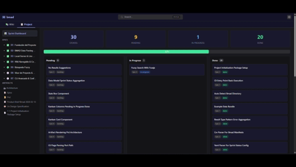

# bmad-viewer

**Stop wasting tokens asking "where am I?"** — see your BMAD project status, browse the full agent/workflow catalog, and search everything with Ctrl+K. Zero tokens, zero config.



## The problem

BMAD is powerful — 21 agents, 43 workflows, hundreds of resources. But:

- **New users** face 500+ markdown files with no map
- **Active developers** burn tokens every morning asking the agent "where did I leave off?"
- **Non-technical stakeholders** can't see project progress without opening a terminal
- **Solo devs** don't know half the capabilities BMAD offers

bmad-viewer fixes all of that with a single command.

## Quick start

**From Claude Code** — just type:

```
/viewer
```

The package ships a `/viewer` slash command. Whenever it is missing, it is copied into `.claude/commands/viewer.md` under the directory you run bmad-viewer from, on any launch, or straight away with `npx bmad-viewer --install-skill`. Run it from your project root so Claude Code finds it. Claude then launches the dashboard for you in the background.

**From terminal:**

```bash
npx bmad-viewer
```

Auto-detects your `_bmad/` folder, opens your browser, dashboard ready.

**From VS Code:**

The [VS Code extension](./apps/vscode-extension/README.md) puts the same dashboard in the editor: an Activity Bar entry, automatic `_bmad/` detection and multi-root workspace support. See its README for install and settings.

## What you get

**Wiki / Catalog** — Browse all BMAD modules (Core, BMB, BMM, CIS) with a navigable sidebar. Click any agent or workflow to read its full description rendered as clean HTML.

**Project Viewer** — Sprint status at a glance: stats boxes + a kanban board with five columns (Backlog → Ready for Dev → In Progress → Review → Done). Reads your `sprint-status` file, either `sprint-status.yaml` or a `sprint-status.md` markdown table. Auto-refreshes when files change on disk.

**Editable board** — Drag a story card to another column and bmad-viewer writes the new status back to your `sprint-status` file (YAML or markdown table). If the story's epic has a status entry, it is recalculated from its stories and written too. If no writable `sprint-status` file is found, the board is read-only, and it is always read-only in `--output` static sites.

**Fuzzy Search (Ctrl+K)** — Find any agent, workflow, or tool instantly. Tolerates typos. You type "brainstrom", you get "brainstorming".

**GitHub sync (optional)** — Push epics and stories to GitHub Issues and a GitHub Project board. See [GitHub sync](#github-sync-optional).

**Dark/Light theme** — In the browser it respects your OS preference, and you can toggle it manually anytime; the choice persists across sessions. In VS Code it follows the editor theme.

## Who is this for

| You are... | You get... |
|------------|-----------|
| New to BMAD | A visual map of everything BMAD offers — no more guessing which agent does what |
| A developer mid-sprint | Sprint dashboard on your second monitor, always up to date, zero tokens spent |
| A solo dev | Discover workflows you didn't know existed via search |
| A stakeholder | A shareable link with project progress — no terminal needed |
| An open source contributor | A complete catalog to understand how BMAD fits together |

## CLI options

```
bmad-viewer [options]

Options:
  --port, -p <port>    Set server port (default: auto-detect from 4000)
  --path <dir>         Path to BMAD project (default: auto-detect _bmad/)
  --output, -o <dir>   Generate static HTML files (no server)
  --no-open            Don't open browser automatically
  --install-skill      Install /viewer slash command for Claude Code
  --version, -v        Show version number
  --help, -h           Show this help message
```

If the port (default or `--port`) is taken, bmad-viewer tries the next nine, and exits with an error if all ten are busy.

## How it works

bmad-viewer reads the files BMAD already generates — CSV manifests, YAML configs, Markdown docs — and renders them as a local HTML dashboard. The filesystem is the database; there is no backend service.

It writes only in these cases:

- **Board drags** update the story's status (and its epic's derived status) in your `sprint-status` file.
- **GitHub sync**, if you connect it, stores its settings in `<project>/.bmad-viewer/integrations.json`, where `<project>` is the folder that contains `_bmad/` (or the one given with `--path`). On GitHub, connecting turns Issues on for the repository if they are off, which needs an admin-level token.
- **Any launch, or `--install-skill`,** copies the `/viewer` command into `.claude/commands/` under the current directory if it is not already there.
- **`--output <dir>`** writes the static HTML site into that directory.

When you edit a file, a file watcher detects the change and pushes an update to your browser via WebSocket. The dashboard refreshes automatically.

## GitHub sync (optional)

In the Project view, click the **GitHub** chip under *Boards*, enter the owner and repository, and click *Connect GitHub*. Then:

- **One way: BMAD → GitHub.** BMAD stays the source of truth. Changes made on GitHub are not pulled back, and the next sync overwrites them.
- **Issues.** Each epic and story becomes a GitHub issue labelled `bmad`, `bmad:epic` or `bmad:story`, `bmad:epic:<n>` and `bmad:status:<status>`. A hidden `<!-- bmad:id=... -->` marker in the issue body ties it to its BMAD item. Done items are closed, and BMAD-marked issues whose item no longer exists are closed too.
- **Project board.** *Sync Project Board* creates a GitHub Project named `<repo> BMAD Board`, or reuses one, and sets each item's `Status`. The board uses the Project's existing Status options, which are GitHub's default *Todo / In Progress / Done* unless you added more. BMAD statuses map to the closest one: Backlog and Ready for Dev become *Todo* (or *Backlog* / *Ready* if present), and Review becomes *In Progress* unless a *Review* option exists.
- **Preview first.** *Preview Sync* shows what would be created, updated or closed; *Sync Now* applies it.
- **Board drags sync automatically.** Once GitHub is connected, dragging a card also syncs that story and its epic to GitHub, including the Project board if you have set one up.

**Token.** A fine-grained token needs **Issues: read and write** on the repository, plus **Projects: read and write** on the owning account or organisation if you use the Project board. A classic token needs the `repo` and `project` scopes. If Issues are disabled on the repository, connecting tries to enable them, which needs admin access.

- **Pasted token:** a token pasted into the panel is saved **in plain text** in `<project>/.bmad-viewer/integrations.json`. Add `.bmad-viewer/` to your project's `.gitignore` so it is never committed, and don't paste a token on a shared machine.
- **Environment variable (recommended):** keep the token out of files. Before connecting, create `<project>/.bmad-viewer/integrations.json` yourself:

  ```json
  { "github": { "owner": "your-org", "repo": "your-repo", "tokenEnvVar": "GITHUB_TOKEN" } }
  ```

  Then start bmad-viewer with that variable set (`GITHUB_TOKEN=... npx bmad-viewer`), and click *Connect GitHub* with the token field left empty. The variable is read from the environment of the process running the server; inside VS Code that is VS Code's own environment. If a pasted token is also stored, it takes precedence over the variable, and the panel cannot clear it, so to switch to the variable, delete the `"token"` key from `integrations.json` by hand. The file must be valid JSON; if it cannot be parsed, bmad-viewer treats GitHub as not connected.

Jira and Azure DevOps are not supported yet; see the [integrations roadmap](./docs/integrations-roadmap.md).

## Requirements

- Node.js 18+ (LTS)
- A project with BMAD installed (`_bmad/` folder)

## Try without a BMAD project

The example data ships in the repository and in the npm package. With `npx`, the package is not in `node_modules`, so point `--path` at a copy on disk:

```bash
# From a clone of this repository
git clone https://github.com/CamiloValderramaGonzalez/bmad-viewer.git
cd bmad-viewer
npm install
node bin/cli.js --path ./example-data

# Or, in a scratch folder, install the package and copy the example out first
npm install bmad-viewer
cp -R ./node_modules/bmad-viewer/example-data ./bmad-example
npx bmad-viewer --path ./bmad-example
```

Dragging cards on the example board edits its `sprint-status.yaml`, and connecting GitHub writes `.bmad-viewer/` next to it, so work on a copy rather than the files inside `node_modules`. `npm install` creates `package.json` and `node_modules` in the folder you run it in.

## Contributing

Issues and PRs welcome at [github.com/CamiloValderramaGonzalez/bmad-viewer](https://github.com/CamiloValderramaGonzalez/bmad-viewer). Before opening a PR, run `npm run check` (lint, then tests); CI runs the same checks on every push and pull request.

## License

MIT
